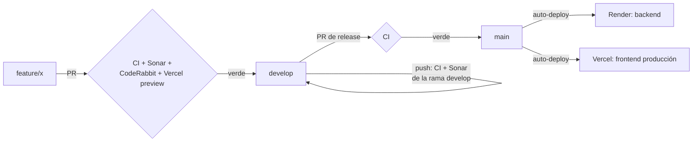

# GitHub Actions y CI/CD

## Resumen: qué se ejecuta en cada PR

Al abrir o actualizar un *pull request* hacia `develop` o `main` aparecen estos **checks**. Solo el primer grupo es GitHub Actions; los demás son aplicaciones externas conectadas al repositorio.

| Check | Quién lo ejecuta | Qué valida | ¿Bloquea el merge? |
|---|---|---|---|
| **Compilar y probar backend** | GitHub Actions (`ci.yml`, job `backend`) | Compila, corre las 203 pruebas, genera el informe y la cobertura y envía el análisis a SonarQube | **Sí** (check obligatorio en la protección de ramas) |
| **Construir imagen Docker** | GitHub Actions (`ci.yml`, job `imagen-docker`) | Que `backend/Dockerfile` construya | No (recomendado hacerlo obligatorio) |
| **SonarCloud Code Analysis** | App de SonarQube Cloud | El *quality gate* del código nuevo del PR | No por configuración, pero hay que revisarlo |
| **CodeRabbit** | App de CodeRabbit | Revisión automática del código, con comentarios en el PR (en español) | No |
| **Vercel** / **Vercel Preview Comments** | App de Vercel | Publica un *preview* del frontend para ese PR | No |

## Cuántos workflows hay

Hay **un solo workflow** de GitHub Actions: `.github/workflows/ci.yml` (nombre **CI**), con **2 jobs**.

> **Historia:** antes había otros dos, `frontend.yml` (publicaba el frontend en Cloudflare Pages) y `deploy-backend.yml` (desplegaba el backend en Cloudflare Containers). Se **eliminaron** en el PR #66, al pasar a Vercel y Render, porque estas plataformas despliegan solas desde GitHub sin necesidad de un workflow. Ver [Despliegue](Deployment).

## `ci.yml` en detalle

### Disparadores (gitflow)

```yaml
on:
  pull_request:
    branches: [develop, main]                          # todo PR hacia las ramas principales
  push:
    branches: [develop, main, 'release/**', 'hotfix/**']   # después de fusionar, y en ramas de release o hotfix
```

Las ramas `feature/*` no disparan el workflow con cada *push*; se validan cuando abren su PR hacia `develop`.

### Job 1: `backend` ("Compilar y probar backend")

Corre en `ubuntu-latest` con un **servicio PostgreSQL 16** temporal:

```yaml
services:
  postgres:
    image: postgres:16
    env:
      POSTGRES_DB: talentmatch_test
      POSTGRES_USER: talentmatch
      POSTGRES_HOST_AUTH_METHOD: trust      # sin contraseña: la BD solo existe durante el job
```

Variables del job: `DB_URL=jdbc:postgresql://localhost:5432/talentmatch_test`, `DB_USER=talentmatch`, `DB_PASSWORD=''` y `SONAR_TOKEN` (desde el secreto).

| # | Paso | Qué hace | Condición |
|---|---|---|---|
| 1 | `actions/checkout@v4` | Descarga el código con **todo el historial** (`fetch-depth: 0`), que SonarQube usa para saber qué código es nuevo | Siempre |
| 2 | Instalar Java 21 | `actions/setup-java@v4` (Temurin) con caché de Maven | Siempre |
| 3 | `./mvnw -B verify` | Compila, ejecuta **todas** las pruebas contra el PostgreSQL del servicio (Flyway crea el esquema y carga los seeds) y genera la cobertura con JaCoCo (`backend/target/site/jacoco/jacoco.xml`) | Siempre. **Si una prueba falla, el job falla** |
| 4 | Generar informe de pruebas | `python3 scripts/reporte_pruebas.py` cruza los XML de Surefire con `docs/pruebas/plan-de-pruebas.csv` y escribe `informe-pruebas/` (HTML, JSON y `resumen.md`). El resumen se agrega a la pestaña **Summary** de la ejecución | `if: always()`: también si fallaron las pruebas |
| 5 | Publicar informe de pruebas | `actions/upload-artifact@v4` sube el artefacto **`informe-pruebas`**: el informe, los reportes de Surefire y la cobertura de JaCoCo | `if: always()` |
| 6 | Análisis de calidad en SonarQube Cloud | `SonarSource/sonarqube-scan-action`, **fijada a su SHA** (`e805d87…`, v8.4.1). Lee `sonar-project.properties` | Solo si los pasos anteriores pasaron **y** existe el secreto `SONAR_TOKEN`. Si no hay secreto, el paso se **omite sin fallar** |

### Job 2: `imagen-docker` ("Construir imagen Docker")

`needs: backend`: solo corre si el job 1 pasó. Ejecuta `docker build -f backend/Dockerfile -t talentmatch-backend:ci .` desde la raíz del repositorio. Sirve para detectar a tiempo un Dockerfile roto, antes de que Render intente desplegarlo. La imagen no se publica en ningún registro.

## Ver los resultados de una ejecución

1. GitHub → pestaña **Actions** → workflow **CI** → la ejecución.
2. En **Summary** está la tabla "Informe de pruebas": ejecutadas, passed, failed, errores y el estado de cada caso CP01 a CP26.
3. Abajo, en **Artifacts**, se descarga **informe-pruebas** (.zip) con `reporte-pruebas.html`, `reporte-pruebas.json`, `surefire-reports/` y `jacoco/` (abre `index.html` para ver la cobertura por clase).

## Secretos y variables

| Nombre | Tipo | Para qué |
|---|---|---|
| `SONAR_TOKEN` | Secret de Actions | Autoriza el envío del análisis a SonarQube Cloud. Se genera en SonarQube Cloud → proyecto → *Administration → Analysis Method → With GitHub Actions* |

El CI no necesita credenciales de base de datos ni de despliegue.

## Protección de ramas

En GitHub → Settings → Branches, `develop` y `main` tienen el check **"Compilar y probar backend"** marcado como obligatorio. Un PR no se puede fusionar si las pruebas fallan. Los administradores pueden forzar el merge (`gh pr merge --admin`), pero el check igual debe estar en verde.

## Aplicaciones externas conectadas

| App | Configuración | Comportamiento |
|---|---|---|
| **CodeRabbit** | `.coderabbit.yaml` | Revisa en español los PRs hacia `develop`, `main` y `revision`, con perfil *chill*. La revisión incremental (en cada push) está apagada para ahorrar cupo: el plan permite 10 revisiones por hora. Para pedir una revisión, comenta `@coderabbitai review` |
| **SonarQube Cloud** | `sonar-project.properties` + secreto `SONAR_TOKEN` | El **análisis automático está desactivado**; el análisis lo envía el CI con la cobertura. El check "SonarCloud Code Analysis" muestra el *quality gate* del PR |
| **Vercel** | `frontend/vercel.json` (Root Directory = `frontend`) | Publica el frontend en cada push: `main` va a producción y las demás ramas o PRs a un *preview* |
| **Render** | `render.yaml` / panel de Render | Despliega el backend en cada push a **`main`** (auto-deploy) |

## Flujo completo, de un cambio a producción



## Problemas conocidos del CI

| Síntoma | Causa | Solución |
|---|---|---|
| `wget: Failed to fetch .../apache-maven-3.9.x-bin.zip` | Falla de red del runner al descargar Maven | *Re-run failed jobs* (`gh run rerun <id> --failed`) |
| El paso de Sonar aparece *skipped* | No existe el secreto `SONAR_TOKEN` | Crear el secreto |
| Sonar falla con "running CI analysis while Automatic Analysis is enabled" | Se reactivó el análisis automático | Desactivarlo en *Administration → Analysis Method* |
| Avisos de Node.js 20 / setup-java v4 *deprecated* | Versiones de las acciones | No bloquean. Migrar a `actions/setup-java@v5` cuando se actualice el workflow |
