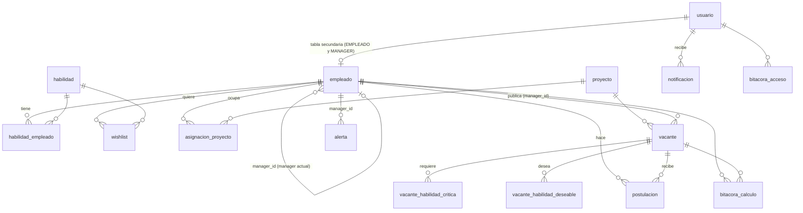

# Modelo de datos

PostgreSQL. El esquema lo crea y actualiza **Flyway** al arrancar el backend. Hibernate está en `ddl-auto: validate`: no crea tablas, solo comprueba que las entidades de `model/` coincidan con ellas. Si no coinciden, la aplicación **no arranca**.

## Diagrama entidad-relación

## Tablas

| Tabla | Contenido | Restricciones importantes |
|---|---|---|
| `usuario` | Todas las personas con acceso: `rol`, `nombre`, `correo` (único), `contrasena_hash` (BCrypt) y `activo` | `rol` ∈ {EMPLEADO, MANAGER, RRHH, LIDER_EJECUTIVO, ADMIN}. Herencia `SINGLE_TABLE` |
| `empleado` | Datos extra de EMPLEADO y MANAGER: `senioridad`, `anios_experiencia`, `area`, `fecha_inicio_rol` (RN-07), `fecha_ingreso_empresa` (RN-21) y `manager_id` (RN-19) | PK = FK a `usuario` |
| `habilidad` | Catálogo | `nombre` único |
| `habilidad_empleado` | Habilidad en el perfil con `estado`, `fecha_aval` y `avalado_por` | Única por empleado y habilidad. Si no está en `AGREGADO`, debe tener fecha y autor del aval |
| `wishlist` | Habilidades que el empleado quiere aprender | PK compuesta |
| `proyecto` | Proyectos con `estado` ACTIVO o CERRADO | — |
| `asignacion_proyecto` | Puesto (`cargo`) de un empleado en un proyecto, con `fecha_inicio`, `fecha_fin` y `motivo_fin` | **`ux_asignacion_vigente`**: una sola asignación sin `fecha_fin` por empleado. `fecha_fin` y `motivo_fin` van juntos |
| `vacante` | Puesto abierto: `estado`, `origen` (MANUAL, RENUNCIA, ROTACION_ACEPTADA, CAMBIO_PROYECTO), fechas y `manager_id` | En `PENDIENTE_ACTIVACION`, `fecha_activacion` es la fecha programada (RN-03) |
| `vacante_habilidad_critica` / `_deseable` | Habilidades requeridas de la vacante | PK compuesta |
| `postulacion` | `match_score`, `puntaje_final` (0 a 100), `estado`, fechas, `posicion_ranking`, `total_candidatos` y `rechazo_directo` (V2) | **`ux_postulacion_activa`**: una sola postulación ACTIVA por empleado y vacante |
| `bitacora_calculo` | Cada cálculo del Puntaje Final con el umbral aplicado y el detalle de la fórmula | **Trigger: solo lectura**. Un UPDATE o DELETE lanza un error (RNF-06) |
| `alerta` | RECHAZOS_REPETIDOS (RN-29) o VACANTE_SIN_MATCH (RN-30), en estado ABIERTA o RESUELTA | — |
| `notificacion` | Notificación in-app para un usuario | — |
| `reporte_mensual` | Resumen del reporte de rechazos de cada mes (V3) | `periodo` (AAAA-MM) único |
| `bitacora_acceso` | Cada acceso denegado (403): usuario, recurso, motivo y fecha (V5) | **Trigger: solo lectura** (solo permite poner `usuario_id` en NULL si se borra el usuario) |

## Migraciones (Flyway)

| Versión | Archivo | Qué hace |
|---|---|---|
| V1 | `database/migrations/V1__esquema_inicial.sql` | Todo el esquema base, índices y el trigger de `bitacora_calculo` |
| V1_1 | `database/seeds/V1_1__datos_prueba.sql` | **Datos de prueba**: 16 usuarios, proyectos, habilidades, asignaciones y vacantes |
| V2 | `database/migrations/V2__rechazo_directo.sql` | Columna `postulacion.rechazo_directo` para distinguir el rechazo directo del manager del "no seleccionado" (RN-29) |
| V3 | `database/migrations/V3__reporte_mensual.sql` | Tabla `reporte_mensual` (HU-002) |
| V4 | `database/migrations/V4__indices_rendimiento.sql` | Índices para el ranking y el cálculo (HU-005) |
| V5 | `database/migrations/V5__bitacora_acceso.sql` | Tabla `bitacora_acceso` con su trigger (HU-006) |
| V5_1 | `database/seeds/V5_1__clave_usuarios_prueba.sql` | Cambia la contraseña de los usuarios de prueba (ids 1 a 16) a `talento` |

Las carpetas que lee Flyway se controlan con la variable `FLYWAY_LOCATIONS`:
- **Por defecto (local y CI):** `migrations` + `seeds`.
- **Solo esquema, sin datos de prueba:** `filesystem:/app/database/migrations`.
- **Producción actual (demo):** `filesystem:/app/database/migrations,filesystem:/app/database/seeds`.

## Reglas de oro de Flyway

1. **Nunca edites una migración que ya se aplicó en algún ambiente**, ni siquiera un comentario. Flyway guarda un *checksum* de cada archivo en `flyway_schema_history` y, si cambia, **la aplicación no arranca** (`Validate failed: Migration checksum mismatch`). Por eso el cambio de contraseña se hizo con una migración nueva (`V5_1`) y no editando `V1_1`.
2. **Cada cambio va en una migración nueva** con la siguiente versión: `V6__descripcion.sql`. El nombre lleva doble guion bajo.
3. **Las versiones deben ser mayores que la última aplicada.** Una versión menor que una ya aplicada (por ejemplo, agregar `V1_2` cuando ya existe `V5`) se rechaza por estar fuera de orden.
4. **Las versiones se comparten entre `migrations/` y `seeds/`:** no repitas un número en las dos carpetas.
5. Si cambias una tabla, actualiza también la entidad JPA, o la validación de Hibernate fallará al arrancar.

## Datos de prueba

`V1_1` y `V5_1` cargan este escenario (contraseña de todos: `talento`):

| Id | Rol | Nombre | Correo |
|---|---|---|---|
| 1 | ADMIN | Administrador TalentMatch | admin@talentmatch.com |
| 2 | RRHH | Laura Rojas | rrhh@talentmatch.com |
| 3 | LIDER_EJECUTIVO | Martin Salazar | lider@talentmatch.com |
| 4 | MANAGER (Backend) | Carlos Perez | carlos.perez@talentmatch.com |
| 5 | MANAGER (Cloud) | Diana Torres | diana.torres@talentmatch.com |
| 6 | MANAGER (Datos) | Andres Gomez | andres.gomez@talentmatch.com |
| 7 a 16 | EMPLEADO | Juan Ramirez, Sofia Castro, Mateo Vargas, Valentina Ruiz, Santiago Mora, Isabella Herrera, Nicolas Rios, Camila Ortiz, Samuel Medina, Mariana Diaz | nombre.apellido@talentmatch.com |

Juan (7) y Valentina (10) llevan menos de 6 meses en su rol: sirven para demostrar el bloqueo de RN-07. Las pruebas de integración (`ApiTest`) usan estos mismos datos.

> Los hashes BCrypt de estos archivos aparecen en SonarQube como vulnerabilidades (`secrets:S8215`). Son datos de demostración. Para un ambiente real hay que quitar `seeds` de `FLYWAY_LOCATIONS` y crear usuarios propios.
