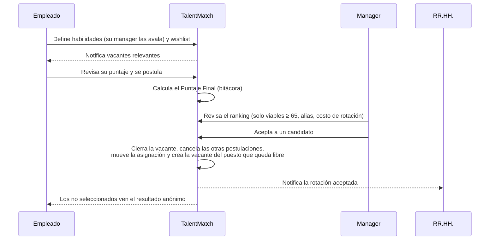

# Problema y solución

## El problema

### Causa raíz
Cuando un ingeniero se aburre o siente que dejó de aprender, **no pide un cambio de proyecto**: busca otra empresa.

### Por qué pasa
1. **Invisibilidad:** el empleado no sabe qué oportunidades existen en su empresa.
2. **Desincentivo del manager:** los líderes retienen a su mejor gente por instinto, aunque eso perjudique a la empresa.
3. **Falta de argumento económico:** nadie le muestra al manager el costo real de perder ese talento.

### Consecuencias
- 💸 La empresa pierde talento conocido y paga entre USD 4 000 y 9 000 en recontratación.
- 🔴 Los proyectos quedan incompletos y el código sin contexto.
- 😞 Los ingenieros se van frustrados por no ver cómo crecer.

## La solución: TalentMatch

### 1. Visibilidad
- El empleado ve todas las vacantes internas y su **Puntaje Final** para cada una antes de postularse.
- **Wishlist:** el empleado marca las habilidades que quiere aprender y recibe una notificación cuando aparece una vacante que las pide.
- **Vacantes automáticas:** cuando alguien deja su puesto, la vacante se crea sola (RN-02).

### 2. Transparencia y mérito
- **Match Score** explicable: habilidades avaladas × 0.7 + senioridad × 0.3. Puntaje Final = Match Score (ver [Algoritmo](Matching-Algorithm)).
- Solo cuentan las habilidades **avaladas** por el manager actual.
- **Ranking inmutable:** nadie puede reordenarlo.
- El candidato no seleccionado ve **automáticamente** el puntaje y las habilidades de quien ganó, sin su identidad.

### 3. Argumento económico y control
- **Costo de rotación** en el desglose: "si renuncia cuesta USD 11 000; rotarlo cuesta USD 2 000; ahorras USD 9 000".
- **Alertas a RR.HH.** si un manager rechaza 2 o más candidatos viables, más un reporte mensual de patrones de rechazo.
- **Top 10** para los líderes ejecutivos: los empleados con más habilidades avaladas, más rotaciones y más antigüedad.

## Flujo resumido

