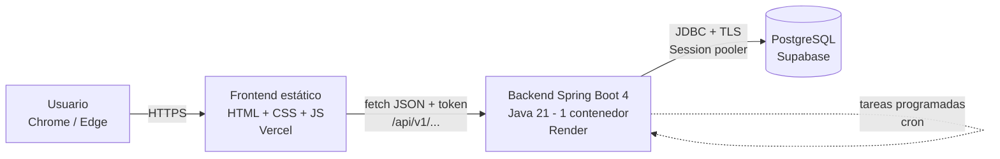
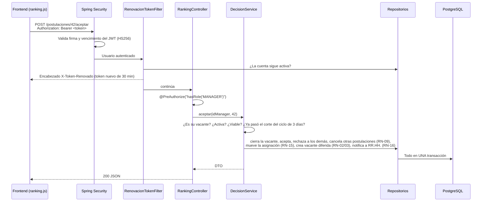

# Arquitectura técnica

## 1. Visión de conjunto

TalentMatch es un **monolito** organizado en **4 capas**: un solo backend Spring Boot que expone una API REST, un frontend estático que la consume y una base de datos PostgreSQL. No hay microservicios. El backend se empaqueta en **un solo contenedor Docker** porque así lo exige Render para ejecutar Java; eso no cambia la arquitectura.



| Pieza | Tecnología | Dónde vive | Carpeta |
|---|---|---|---|
| Backend / API | Java 21, Spring Boot 4.1.1, Spring Security, Spring Data JPA (Hibernate 7), Flyway, Maven | Render (contenedor Docker, plan Free) | `backend/` |
| Frontend | HTML, CSS y JavaScript con módulos ES, **sin framework ni compilación** | Vercel (sitio estático, plan Hobby) | `frontend/` |
| Base de datos | PostgreSQL (16 en CI, 18 en local, Supabase en producción) | Supabase (plan Free) | `database/` |
| Parámetros de negocio | YAML leído al arrancar | Dentro de la imagen | `conf/` |
| CI | GitHub Actions | GitHub | `.github/workflows/` |
| Calidad | JaCoCo, SonarQube Cloud, CodeRabbit | Nube | `sonar-project.properties`, `.coderabbit.yaml` |

## 2. Estructura del repositorio

```
TalentMatch/
├── backend/                 API Spring Boot (proyecto Maven con wrapper ./mvnw)
│   ├── src/main/java/co/edu/javeriana/talentmatch/
│   │   ├── controller/      Capa 2: endpoints REST y manejo de errores
│   │   ├── service/         Capa 3: TODA la lógica de negocio
│   │   ├── repository/      Capa 4: acceso a datos (Spring Data JPA)
│   │   ├── model/           Entidades del diagrama de clases (JPA)
│   │   ├── dto/             Contratos JSON de entrada y salida
│   │   ├── security/        Login, token JWT, permisos y bitácora de accesos
│   │   └── config/          Lectura de conf/config.yaml, tareas programadas, reloj, filtros
│   ├── src/main/resources/application.yml
│   ├── src/test/java/...    203 pruebas JUnit 5 (misma estructura de paquetes)
│   ├── Dockerfile           Imagen multi-etapa (se construye desde la RAÍZ del repo)
│   └── pom.xml
├── frontend/                Capa 1: sitio estático
│   ├── index.html           Login
│   ├── pages/               Una página por pantalla (20 páginas)
│   ├── js/                  api.js, auth.js, layout.js, ui.js, config.js, ambiente.js...
│   ├── js/pages/            Un módulo JS por página
│   ├── css/
│   ├── scripts/generar-ambiente.mjs   Escribe la URL de la API al publicar en Vercel
│   └── vercel.json
├── database/
│   ├── migrations/          V1..V5: esquema (Flyway)
│   └── seeds/               V1_1 y V5_1: datos de prueba (Flyway, opcional)
├── conf/config.example.yaml Parámetros de negocio (umbral, pesos, plazos...)
├── docs/                    Especificación formal, matriz de permisos, plan de pruebas, copia de la wiki
├── scripts/                 setup.sh, deploy.sh, reporte_pruebas.py
├── .github/workflows/ci.yml Único workflow de GitHub Actions
├── render.yaml              Blueprint de Render (backend)
├── sonar-project.properties Configuración de SonarQube Cloud
└── .coderabbit.yaml         Configuración de CodeRabbit (revisión automática de PRs)
```

## 3. Las 4 capas

| # | Capa | Paquete o carpeta | Responsabilidad | Lo que NO hace |
|---|---|---|---|---|
| 1 | Presentación | `frontend/` | Mostrar datos y capturar acciones del usuario | No calcula ni decide nada del negocio |
| 2 | Controladores | `controller/` | Recibir la petición HTTP, validar el formato (`@Valid`), comprobar el rol (`@PreAuthorize`) y delegar | No tiene reglas de negocio |
| 3 | Servicios | `service/` | **Toda** la lógica de negocio: reglas RN-xx, cálculos, transacciones, notificaciones | No conoce HTTP |
| 4 | Repositorios | `repository/` | Leer y guardar entidades (Spring Data JPA) | No decide nada |

El modelo de dominio (`model/`) es transversal: las entidades JPA también contienen **reglas de su propio estado**. Por ejemplo, `Vacante.activar()` rechaza activar una vacante cerrada y `Postulacion.resolver()` rechaza resolver una postulación que ya no está activa. Los servicios orquestan y las entidades protegen su consistencia.

## 4. Ciclo de vida de una petición

Ejemplo: el manager acepta a un candidato (`POST /api/v1/postulaciones/{id}/aceptar`).



Si algo falla dentro del servicio, la excepción sube a `ManejadorErrores`, que la traduce a un código HTTP con un mensaje en español:

| Excepción | HTTP | Cuándo |
|---|---|---|
| `MethodArgumentNotValidException`, `DatosInvalidosException` | 400 | Campos inválidos. La respuesta incluye `campos` para marcar el formulario |
| `HttpMessageNotReadableException`, `MethodArgumentTypeMismatchException` | 400 | JSON mal formado o tipo incorrecto |
| `CredencialesInvalidasException` | 401 | Login fallido o cuenta desactivada |
| Sin token o token vencido | 401 | Lo responde Spring Security (`RespuestasSeguridad`) |
| `AccesoDenegadoException` o rol incorrecto | 403 | Se registra en `bitacora_acceso` |
| `RecursoNoEncontradoException` | 404 | El id no existe |
| `ReglaNegocioException` | 409 | Se violó una regla de negocio (por ejemplo, "ya tienes una postulación activa") |

## 5. Piezas transversales

| Pieza | Clase | Para qué |
|---|---|---|
| Parámetros de negocio | `config/*Properties` + `service/ParametrosService` | Los valores de `conf/config.yaml` (umbral 65, pesos 0.7 y 0.3, plazos...) se cargan como `@ConfigurationProperties`. **Ningún valor de negocio está fijo en el código** (RNF-12). |
| Reloj | `config/RelojConfig` (bean `Clock`) | Todos los servicios usan `LocalDateTime.now(reloj)`. Las pruebas inyectan un reloj fijo y así las reglas de "6 meses" o "24 horas" son repetibles. |
| Tareas programadas | `config/TareasProgramadas` | Tres cron (ver la sección 6). La lógica vive en los servicios. |
| Tiempos de respuesta | `config/TiemposRespuestaFilter` | Registra en el log la duración de cada petición con la etiqueta `tiempo-respuesta` (HU-005). |
| Eventos de la decisión | `DecisionService.EventosDecision` | Interfaz de *listener* que implementan `AlertaService` y `ResultadoService`: cuando el manager acepta o rechaza, se generan las alertas (RN-29) y los resultados (RN-18) sin acoplar los servicios entre sí. |
| Notificaciones | `NotificacionService` | Se guardan en la misma transacción que el evento que las origina (RNF-08). |
| Bitácora de cálculo | `BitacoraCalculo` (`@Immutable`) + trigger SQL | Cada cálculo del Puntaje Final queda registrado y **no se puede modificar ni borrar** (RNF-06). |
| Bitácora de accesos | `security/RegistroAccesosDenegados` | Cada 403 se guarda en `bitacora_acceso`, con trigger de solo lectura (HU-006). |

## 6. Tareas programadas (cron)

Definidas en `application.yml`, en `talentmatch.tareas.*`. Se pueden apagar con `TAREAS_HABILITADAS=false`.

| Tarea | Cron por defecto | Regla | Servicio |
|---|---|---|---|
| Activar vacantes cuya ventana de 24 h ya pasó | `0 * * * * *` (cada minuto) | RN-03 | `VacanteAutomaticaService.activarPendientes` |
| Alertar vacantes sin match después de 10 días | `0 0 7 * * *` (todos los días a las 7:00) | RN-05 y RN-30 | `VacanteAutomaticaService.revisarVacantesSinMatch` |
| Generar el reporte mensual de rechazos | `0 0 2 1 * *` (el día 1 a las 2:00) | HU-002 | `ReporteRechazosService` |

> En el plan Free de Render el servicio **se duerme** tras 15 minutos sin tráfico. Mientras duerme no corren los cron. Al despertar se ponen al día en la siguiente ejecución, porque cada tarea revisa el estado actual y no "eventos perdidos".

## 7. Decisiones de arquitectura

| Decisión | Por qué |
|---|---|
| Monolito y no microservicios | El dominio es pequeño y las reglas cruzan entidades: aceptar a un candidato toca vacantes, postulaciones, asignaciones y notificaciones en una sola transacción. |
| Lógica en la capa Service, no en el frontend | El frontend es manipulable. Toda regla se valida en el servidor y el frontend solo muestra mensajes. |
| Fórmula sin IA y parametrizable | Requisito de neutralidad y auditabilidad (RNF-09, RNF-06): cualquiera puede recalcular el puntaje a mano. |
| `ddl-auto: validate` + Flyway | Las tablas las crea Flyway. Hibernate solo **valida** al arrancar que las entidades coincidan con las tablas; si no coinciden, la app no arranca. |
| Herencia `SINGLE_TABLE` en `usuario` | Un solo login para los 5 roles. Columna discriminadora `rol`. `Empleado` y `Manager` guardan sus datos extra en la tabla secundaria `empleado`. |
| JWT HS256 sin estado + renovación por petición | Escala sin sesiones en el servidor y cumple la expiración por **inactividad** de 30 minutos (HU-006). |
| Frontend sin framework | Requisito del curso y despliegue trivial: archivos estáticos, sin `npm install` ni compilación. |
| Un solo workflow de CI | Vercel y Render despliegan solos desde GitHub. El CI solo valida: pruebas, informe, cobertura, Sonar y build de Docker. |

Ver también: [Guía del backend](Backend) · [Modelo de datos](Database-Model) · [Seguridad](Security) · [Despliegue](Deployment).
