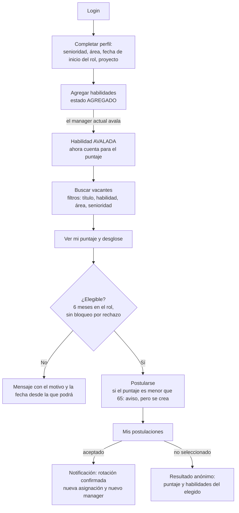
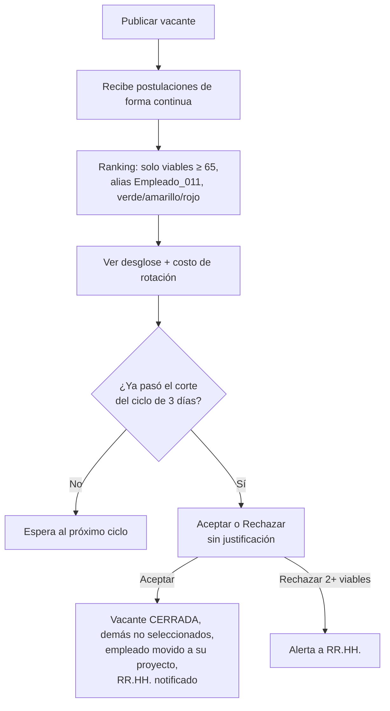
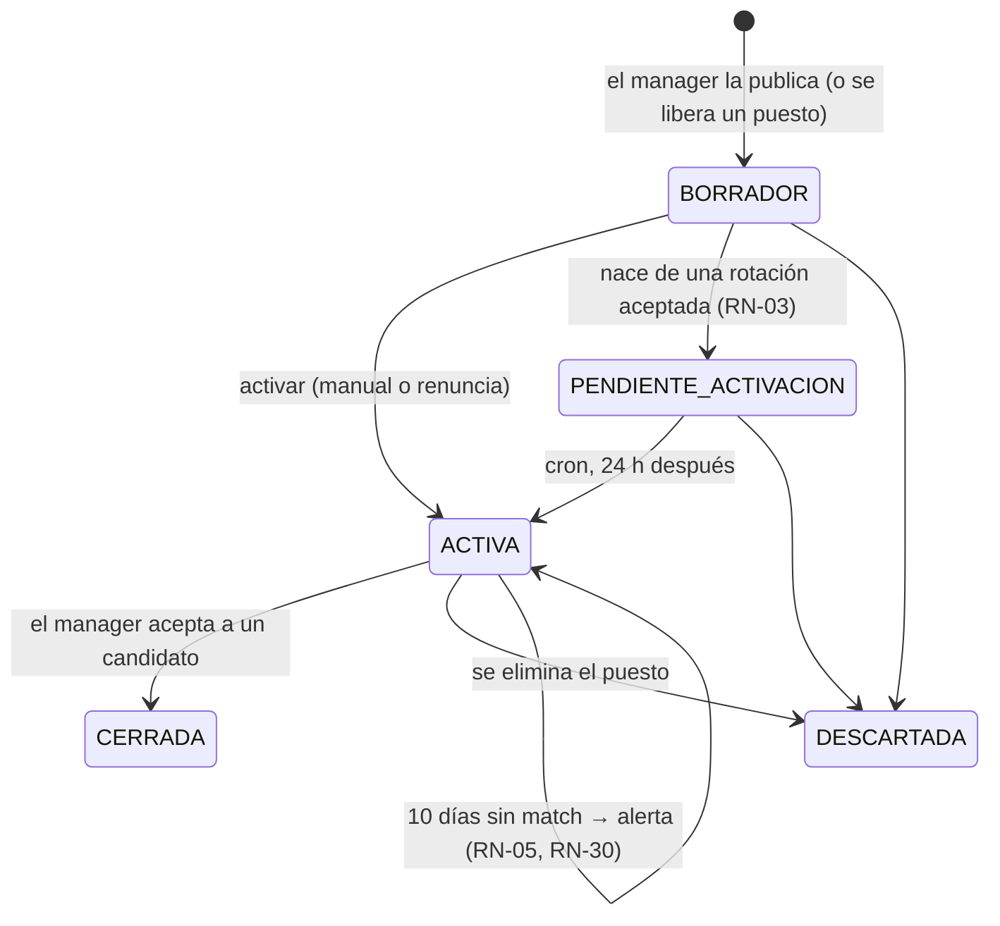

# Roles y flujos

TalentMatch tiene **5 roles**. Cada uno ve un panel y un menú distintos (ver [Frontend](Frontend#pantallas-por-rol)). Los permisos exactos están en [Seguridad](Security) y en `docs/seguridad/Matriz-de-Permisos.md`.

## Empleado

**Qué puede hacer:** completar su perfil, declarar habilidades (quedan en `AGREGADO` hasta que su manager las avala), armar su wishlist, buscar vacantes, ver su puntaje para cada una, postularse y ver el estado y el resultado de sus postulaciones.

Reglas clave: RN-07 (6 meses), RN-08 (varias postulaciones a la vez), RN-09 (al aceptar una, las demás se cancelan), RN-10 (repostulación) y RN-18 (resultado anónimo).

## Manager

Es también un empleado: tiene perfil y puede postularse, pero no a sus propias vacantes.

**Qué puede hacer:**
- Publicar vacantes con habilidades críticas y deseables.
- Avalar o rechazar las habilidades de **su** equipo.
- Ver el ranking de **sus** vacantes y el desglose de cada candidato, con el costo de rotación.
- Aceptar o rechazar candidatos.

No puede reordenar el ranking (RN-14): cualquier intento responde 409.

## Analista de RR.HH.

**Qué puede hacer:**
- Atender las **alertas**: rechazos repetidos (RN-29) y vacantes sin match (RN-30).
- Ver el **reporte mensual de rechazos** por manager y descargarlo en CSV (HU-002).
- Ver el **top 10**.
- Gestionar **asignaciones** (liberar un puesto crea la vacante automática).
- Ver todas las **vacantes por estado**.
- Consultar el **historial** completo de un empleado, incluidas sus postulaciones.
- Revisar la **bitácora de accesos denegados**.
- Ver cualquier ranking y su desglose (sin decidir).

Recibe la notificación de cada rotación aceptada y la formaliza fuera de la app (RN-16).

## Líder Ejecutivo

Ve el **reporte top 10** (RN-21): los empleados con más habilidades avaladas, más rotaciones y más años en la empresa. Es un insumo para ascensos; la decisión queda fuera de la app.

## Administrador

Gestiona los **usuarios**: lista, cambio de rol y activación o desactivación. Una cuenta desactivada pierde la sesión de inmediato.

## Flujo de una vacante, de principio a fin

Al aceptar a Santiago en "Backend Senior" (proyecto Pagos):
1. La vacante se cierra.
2. Los demás candidatos quedan RECHAZADA, con su posición registrada ("fuiste #2 de 5").
3. Las otras postulaciones activas de Santiago pasan a CANCELADA_POR_ROTACION, sin avisar a sus managers.
4. Su asignación anterior termina (ROTACION_ACEPTADA) y se crea la nueva en Pagos. Su manager pasa a ser Carlos.
5. Su puesto anterior genera una vacante en PENDIENTE_ACTIVACION que se activa 24 h después (RN-02, RN-03, RN-04).
6. RR.HH. recibe la notificación (RN-16).
